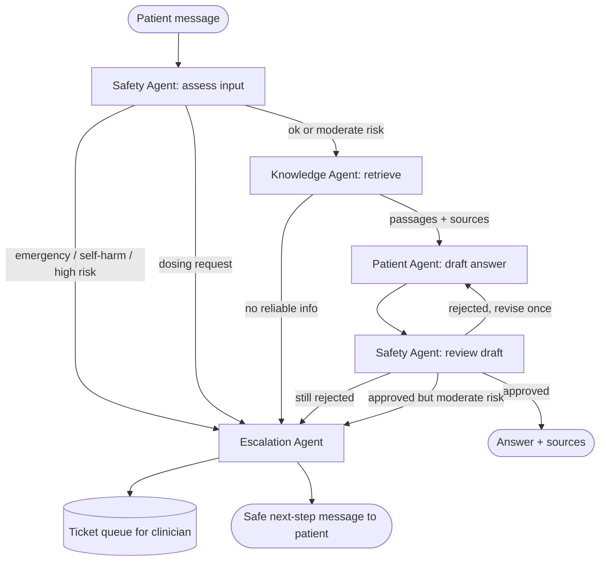

# 🩺 Diabetes Multi-Agent Care Assistant

A **multi-agent AI system** where specialized agents collaborate to answer patient questions about diabetes safely. One agent talks to the patient, one retrieves medical knowledge, one checks safety, and one escalates to a healthcare professional.

> ⚠️ **Medical disclaimer:** This is a technical demonstration and educational tool. It is **not** a medical device and does **not** provide medical advice, diagnosis, or treatment. The sample knowledge base is illustrative only. A real deployment needs clinician-reviewed content, clinical safety validation, and legal/regulatory review (HIPAA, GDPR, local medical-device rules).

---

## 👥 The agents

| Agent | Role | Talks to patient? | Uses LLM? |
|---|---|:---:|:---:|
| 💬 **Patient Agent** | Drafts plain-language answers grounded in retrieved knowledge; revises drafts that fail review | Yes | Yes |
| 📚 **Knowledge Agent** | Rewrites the question into clinical keywords and retrieves vetted passages with sources | No | Yes (query rewrite) |
| 🛡️ **Safety Agent** | Triage of the *incoming* message and review of the *outgoing* draft. Rules first, LLM second, fails safe | No | Yes + rules |
| 🚨 **Escalation Agent** | Writes an SBAR handoff note, queues a ticket for a clinician, and gives the patient the right next-step message | Via fixed notices | Yes (summary) |

An **Orchestrator** coordinates them and records a **trace** of which agent did what.

## 🔀 How they collaborate



### Escalation policy

| Trigger | Urgency | What the patient sees | Clinician ticket |
|---|---|---|---|
| Emergency or self-harm red flag | 🔴 `emergency` | Call emergency services / 988 | ✅ |
| LLM triage says `high` risk | 🟠 `urgent` | Contact care team today | ✅ |
| Medication or insulin dosing request | 🟡 `routine` | Redirected to care team | ✅ |
| No reliable knowledge found | 🟡 `routine` | "I can't answer safely" + flagged | ✅ (configurable) |
| Draft failed safety review twice | 🟡 `routine` | Safe fallback message | ✅ |
| Moderate risk but answerable | 🟡 `routine` | Answer **plus** follow-up notice | ✅ |
| Low / none | none | Normal answer | ❌ |

## 🛡️ Safety design

1. **Defense in depth.** Hard red flags are caught by deterministic rules *before* any LLM is called, so emergencies never depend on model behavior.
2. **Two checkpoints.** The Safety Agent screens the input and then reviews the output (blocking dose instructions, diagnoses, and claims not in the context).
3. **Fail safe.** If a classifier or reviewer errors or returns unparseable output, the system treats the case as higher risk, never lower.
4. **Separation of duties.** The agent that writes the answer is not the one that approves it.
5. **Human in the loop.** Anything uncertain, risky, or out of scope becomes a ticket for a person.
6. **Bounded loops.** Revisions are capped (`MAX_REVISIONS`), so agents can't loop forever.

## 📁 Project structure

```
diabetes-multiagent/
├── data/knowledge/                 # Markdown knowledge base (replace with vetted content)
├── src/diabetes_agents/
│   ├── agents/
│   │   ├── patient.py              # Patient Agent
│   │   ├── knowledge.py            # Knowledge Agent
│   │   ├── safety.py               # Safety Agent (input triage + draft review)
│   │   └── escalation.py           # Escalation Agent + ticket notifier
│   ├── orchestrator.py             # Pipeline coordination and trace
│   ├── rules.py                    # Deterministic red-flag rules
│   ├── retriever.py                # TF-IDF retrieval over markdown sections
│   ├── llm.py                      # Anthropic client + offline FakeLLM
│   ├── models.py                   # Typed messages between agents
│   ├── config.py                   # Settings from environment
│   ├── api.py                      # FastAPI app
│   └── cli.py                      # Terminal chat with --trace
├── tests/
└── .github/workflows/ci.yml
```

## 🚀 Quick start

```bash
git clone https://github.com/<your-username>/diabetes-multiagent.git
cd diabetes-multiagent

python -m venv .venv && source .venv/bin/activate   # Windows: .venv\Scripts\activate
pip install -r requirements.txt
cp .env.example .env
```

### Option A: Offline demo (no API key)
Uses a deterministic fake LLM so you can see the agent flow immediately.
```bash
DEMO_MODE=1 PYTHONPATH=src python -m diabetes_agents.cli --trace
```

### Option B: Live with Claude
Set `ANTHROPIC_API_KEY` in `.env`, then:
```bash
PYTHONPATH=src python -m diabetes_agents.cli --trace
```

### Run the API
```bash
PYTHONPATH=src uvicorn diabetes_agents.api:app --reload
```
```bash
curl -X POST localhost:8000/chat -H "Content-Type: application/json" \
  -d '{"session_id":"demo","message":"My dad is unconscious","include_trace":true}'

curl localhost:8000/escalations     # clinician queue (protect with auth in production)
```
Interactive docs: http://localhost:8000/docs

## 🎬 Example run (`DEMO_MODE=1 --trace`)

```
You: How do I treat low blood sugar?
Bot: Here is what our patient information says: ...
Sources: Hypoglycemia > What it is; Hyperglycemia and DKA > Sick day basics; ...
  - safety     assess_input  risk=none category=none via=rules
  - knowledge  retrieve      3 passages, top_score=0.28
  - patient    draft         211 chars
  - safety     review_draft  approved=True issues=[]

You: Should I increase my insulin tonight?
Bot: I can't recommend or change medication or insulin doses ... I have passed your question to your care team.
[Escalated: ticket 1bc1a0a3, urgency=routine]
  - safety     assess_input  risk=moderate category=dosing via=rules
  - escalation ticket        1bc1a0a3 urgency=routine

You: My dad is unconscious
Bot: This could be a medical emergency. Please call your local emergency number (911 in the US) ...
[Escalated: ticket 43c5599a, urgency=emergency]
  - safety     assess_input  risk=emergency category=emergency via=rules
  - escalation ticket        43c5599a urgency=emergency
```
Notice the emergency case never reaches the Knowledge or Patient agents.

In demo mode the "answer" is just the top retrieved passage. With a real LLM the Patient Agent writes a proper grounded response.

## ⚙️ Configuration

| Variable | Default | Description |
|---|---|---|
| `ANTHROPIC_API_KEY` | none | Your API key (omit to fall back to demo mode) |
| `MODEL_NAME` | `claude-sonnet-5-5` | Claude model |
| `DEMO_MODE` | `0` | `1` = offline fake LLM |
| `TOP_K` | `3` | Passages retrieved per question |
| `MIN_RETRIEVAL_SCORE` | `0.05` | Minimum similarity to count as a match |
| `MAX_REVISIONS` | `1` | Rewrite attempts after a failed safety review |
| `MAX_HISTORY_TURNS` | `6` | Conversation turns remembered |
| `ESCALATE_ON_NO_KNOWLEDGE` | `1` | Create a ticket when nothing relevant is found |
| `ESCALATION_DIR` | `./escalations` | Where tickets are written |

## 🧪 Tests

```bash
PYTHONPATH=src pytest -q
```
The tests use the fake LLM, so they need no API key. They cover emergencies bypassing the LLM, self-harm escalation, dosing redirects, unknown topics, unsafe drafts being blocked after revision, classifier failure failing safe, and ticket persistence.

## 🔌 Extending

- **Add an agent:** create a class in `agents/`, give it a narrow job and its own system prompt, and call it from `orchestrator.py`.
- **Real notifications:** replace `FileNotifier` with email, SMS, pager, Slack, or EHR integration (same `notify(ticket)` interface).
- **Better retrieval:** swap `retriever.py` for embeddings plus a vector DB. The Knowledge Agent's interface stays the same.
- **Your content:** drop `.md` files into `data/knowledge/` (`# Topic`, `## Section`). Use only clinician-reviewed sources.

## 🔐 Privacy notes

Tickets contain patient messages (PHI). The default file queue is for demos only. In production use encryption at rest, access control, audit logs, retention policies, and a signed BAA with any LLM vendor where required. No message logging is added beyond the ticket queue.

## 🗺️ Roadmap

- [ ] Embedding-based retrieval and vector DB
- [ ] Async agents and streaming responses
- [ ] Clinician dashboard to review and resolve tickets
- [ ] Authentication and audit trail
- [ ] Multilingual support
- [ ] Clinician-graded evaluation set and red-team tests
- [ ] Agent framework adapters (LangGraph, AutoGen)

## 🤝 Contributing

Issues and PRs are welcome. Medical content contributions must cite a reputable source.

## 📄 License

MIT. See [LICENSE](LICENSE).
